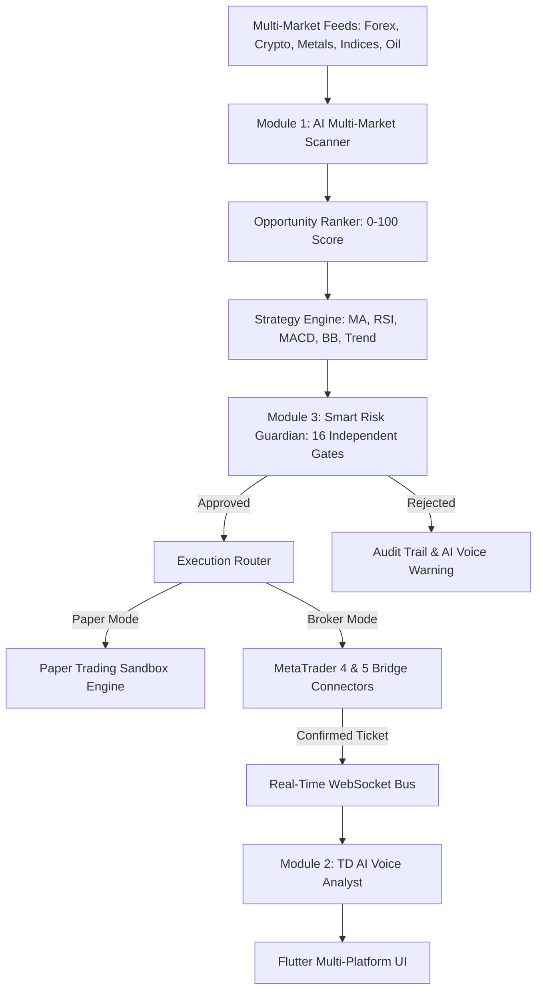

# TD TRADER – Advanced AI Trading Ecosystem
### *Trade Smarter. Think Faster. Let AI Explain.*
**Copyright © 2026 TechDaddy. All rights reserved.**  
**Owned and Developed Exclusively by TechDaddy Fintech Systems**

[](LICENSE)
[](https://github.com/techdaddyhub/td_trader/actions/workflows/ci.yml)
[](https://github.com/techdaddyhub/td_trader/actions/workflows/release.yml)
[](https://github.com/techdaddyhub/td_trader/releases)
[](https://github.com/techdaddyhub/td_trader/releases)

```
   █████████  ██████████   
      ██      ██       ██  
      ██      ██       ██  [TECHDADDY]
      ██      ██       ██  TD TRADER ECOSYSTEM
      ██      ██████████   Copyright © 2026 TechDaddy
```

---

## 📥 Direct App Downloads (Latest Release)

Users can immediately download and launch TD TRADER on any supported operating system:

| Platform | Download Link | File Format | System Requirements |
| :--- | :--- | :--- | :--- |
| 📱 **Android** | [**Download Android APK**](../../releases/latest/download/TDTrader-Android.apk) | `.apk` | Android 8.0 (Oreo) or higher |
| 💻 **Windows** | [**Download Windows App**](../../releases/latest/download/TDTrader-Windows-x64.zip) | Portable `.zip` | Windows 10 / 11 (64-bit) |
| 🐧 **Linux** | [**Download Linux Bundle**](../../releases/latest/download/TDTrader-Linux-x64.tar.gz) | `.tar.gz` | Ubuntu, Debian, Fedora, Arch (x86_64) |
| 🍎 **macOS** | [**Download macOS App**](../../releases/latest/download/TDTrader-macOS.zip) | `.zip` | macOS 12+ (Intel & Apple Silicon) |
| 🌐 **Web SPA** | [**Download Web Bundle**](../../releases/latest/download/TDTrader-Web-App.zip) | `.zip` | Any modern browser (Chrome, Firefox, Safari) |

### ⚡ MetaTrader 4 & MetaTrader 5 Expert Advisors (EAs)
* [**Download `TDTrader_Bridge_MT4.mq4`**](../../releases/latest/download/TDTrader_Bridge_MT4.mq4) (Drop into `MQL4/Experts/`)
* [**Download `TDTrader_Bridge_MT5.mq5`**](../../releases/latest/download/TDTrader_Bridge_MT5.mq5) (Drop into `MQL5/Experts/`)

---

## 🏛️ Architecture Overview



---

## 🚀 The Five Mandatory Core Modules

### 1. AI Multi-Market Scanner
* **Supported Asset Classes**: Forex (`EURUSD`, `GBPUSD`, `USDJPY`, `AUDUSD`, `USDCAD`, etc.), Cryptocurrency (`BTCUSD`, `ETHUSD`, `SOLUSD`, `XRPUSD`), Precious Metals (`XAUUSD`, `XAGUSD`), Indices (`US30`, `NAS100`, `SPX500`, `GER40`), and Commodities (`USOIL`, `UKOIL`, `NATGAS`).
* **Multi-Timeframe Monitoring**: Simultaneous analysis across `M5`, `M15`, `M30`, `H1`, `H4`, and `D1`.
* **Smart Money Concepts (SMC)**: Higher Highs/Lows, Break of Structure (BOS), Change of Character (CHoCH), Supply/Demand Order Blocks, and Liquidity Sweeps with wick rejections.
* **Transparent 0-100 Opportunity Ranking System**:
  $$\text{Score} = \text{Trend} (20) + \text{Tech Conf} (20) + \text{Momentum} (15) + \text{Structure} (15) + \text{Volatility} (10) + \text{R:R} (10) + \text{Strategy} (10)$$

### 2. TD AI Voice – Personal Trading Analyst
* **Voice Personalities**: `Aria_Fintech_Pro`, `Sophia_Macro_Strategist`, `Marcus_Quant_Lead`, and `Alexander_Institutional`.
* **Dynamic Speech Controls**: Adjustable rate (0.5x – 2.0x), volume (0.0 – 1.0), and immediate interruption controls.
* **Standardized Mandatory Audio Alerts**:
  * *NEW SIGNAL*: Alerts on validated opportunities with entry, SL, and TP.
  * *TRADE EXECUTION*: Confirms broker fill ticket, slippage, and position tracking.
  * *TRADE CLOSURE*: Announces final outcome including trading costs and commission.
  * *MARKET ALERT*: Warns of rapid volatility expansions.
  * *RISK ALERT*: Alerts when daily loss threshold triggers automated protection.
* **Conversational Grounding**: Strictly separates verified database facts from qualitative quantitative interpretation.

### 3. Smart Risk Guardian
* **Independent Execution**: Operates 100% independently from the AI language model.
* **16 Deterministic Risk Gates**:
  1. *Emergency Pause Gate*
  2. *Risk Guardian Tripped Gate*
  3. *Auto-Trading Authorization Gate*
  4. *Live Account Explicit Authorization Gate*
  5. *Mandatory Stop Loss Gate*
  6. *Directional SL Sanity Gate*
  7. *Take-Profit & R:R Minimum (>= 1.0) Gate*
  8. *Consecutive Loss Lockout Gate*
  9. *Max Daily Loss Amount Gate*
  10. *Max Daily Loss Percentage Gate*
  11. *Trailing Daily Drawdown Gate*
  12. *Total Account Drawdown Gate*
  13. *Max Open Trades Concurrency Gate*
  14. *Correlated Currency/Asset Exposure Gate*
  15. *Maximum Lot Size Gate*
  16. *Free Margin Adequacy Gate*
* **Mathematical Dynamic Lot Sizing**:
  $$\text{Lot Size} = \frac{\text{Account Equity} \times (\text{Risk \%} / 100)}{\text{Stop Loss Pips} \times \text{Pip Value Per Lot}}$$
* **Emergency Control Panel**: Instant `PAUSE AI TRADING`, `STOP ALL NEW TRADES`, `CANCEL PENDING ORDERS`, and `CLOSE ALL OPEN POSITIONS` (with explicit confirmation).

### 4. AI Strategy Backtester & Quant Laboratory
* **Intra-Bar High/Low Simulation**: Evaluates intra-candle price paths with realistic spread (1.2 pips), execution slippage (0.5 pips), and broker commissions ($5/lot round-turn).
* **Analytics**: Win Rate, Gross/Net Profit, Profit Factor, Maximum Drawdown, Sharpe Ratio, Expectancy, and Average Holding Duration.
* **Walk-Forward Analysis (WFA)**: 70% In-Sample training / 30% Out-of-Sample testing with Walk-Forward Efficiency (WFE) verification to mitigate curve-fitting and overfitting.
* **Side-by-Side Comparison**: Simultaneous evaluation of Moving Average Crossover, RSI Reversal, MACD Momentum, Bollinger Breakout, and Trend Following on identical data.

### 5. Multi-Account Manager & MetaTrader Bridge
* **Multi-Platform Support**: MT4 Demo, MT4 Live, MT5 Demo, MT5 Live, and TD Paper Trading.
* **Strict Account Isolation**: Capital and risk metrics are strictly ring-fenced per account; balances are never pooled or commingled.
* **AES-256 Encrypted Credential Security**: Broker passwords are encrypted with AES-256 Fernet; credentials are never stored in plaintext and exist unencrypted only in volatile memory during authentication.
* **Broker Confirmation Handshake**: Never assumes an order has executed until the MetaTrader bridge returns a confirmed broker ticket number, fill price, timestamp, and fill volume.

---

## 🛠️ Local Development & Quickstart

### Backend Server Setup
```bash
# 1. Install dependencies
pip install -r td_trader/requirements.txt

# 2. Start ASGI server on http://0.0.0.0:8000
python3 td_trader/infrastructure/scripts/start_server.py
```

### Docker Deployment
```bash
docker-compose up -d
```

### MetaTrader 4 / 5 Bridge Installation
1. Open your MetaTrader client terminal.
2. Select **File -> Open Data Folder**.
3. Copy `td_trader/metatrader_bridge/experts/TDTrader_Bridge_MT4.mq4` into `MQL4/Experts/` (or `TDTrader_Bridge_MT5.mq5` into `MQL5/Experts/`).
4. In MetaTrader, go to **Tools -> Options -> Expert Advisors**:
   * Enable **Allow automated trading**.
   * Enable **Allow WebRequest for listed URL** and add `http://127.0.0.1:8000`.
5. Attach the EA to any chart window.

### Flutter Multi-Platform App
```bash
cd td_trader/frontend
flutter pub get
flutter run -d chrome # Or: windows, macos, linux, android
```

---

## 🧪 Automated Test Suite

Run the master test suite:
```bash
python3 -m unittest td_trader/infrastructure/tests/test_master_suite.py
```

All 6 test cases pass with 100% verification across security, scanner, voice synthesis, risk gates, backtesting, and account isolation.

---

## ⚖️ Legal & Intellectual Property Notice

**Copyright © 2026 TechDaddy. All rights reserved.**  
All proprietary rights, trade secrets, software code, algorithms, and brand trademarks (`TD`, `TD TRADER`, `TechDaddy`) are owned exclusively by **TechDaddy Fintech Systems**.

Unauthorized distribution, reverse engineering, or reproduction is strictly prohibited. For licensing inquiries, contact [TechDaddy GitHub](https://github.com/techdaddyhub).

