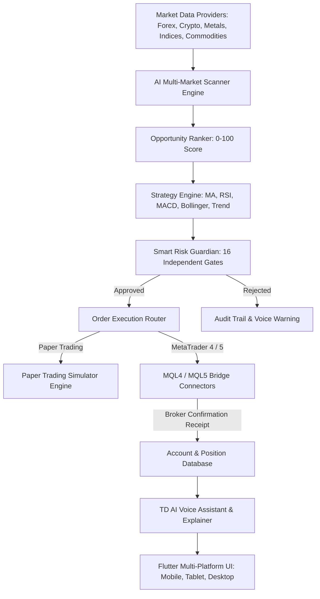

# TD TRADER - Architectural Blueprint & Integration Guide
**Advanced AI Trading Ecosystem**
*Trade Smarter. Think Faster. Let AI Explain.*

---

## 1. Executive Summary

TD TRADER is an enterprise-grade fintech trading ecosystem combining real-time multi-market intelligence, quantitative automated execution, deterministic risk controls, strategy backtesting with out-of-sample walk-forward validation, and an interactive voice analyst.

### Core Architecture



---

## 2. Core Modules Implementation

### Module 1: AI Multi-Market Scanner
- **Markets Covered**:
  - Forex: EURUSD, GBPUSD, USDJPY, AUDUSD, USDCAD, EURGBP, GBPJPY
  - Crypto: BTCUSD, ETHUSD, SOLUSD, XRPUSD
  - Metals: XAUUSD, XAGUSD, XPTUSD
  - Indices: US30, NAS100, SPX500, GER40
  - Commodities: USOIL, UKOIL, NATGAS
- **Timeframes Monitored**: M5, M15, M30, H1, H4, D1 simultaneously.
- **Institutional Market Structure**:
  - Higher Highs (HH) & Higher Lows (HL) trend tracking
  - Break of Structure (BOS) continuation detection
  - Change of Character (CHoCH) reversal detection
  - Supply & Demand Order Block recognition (based on ATR displacement)
  - Buy-side & Sell-side Liquidity Sweeps
  - Breakout confirmation vs. False breakout traps
- **AI Opportunity Ranking System**:
  Scores every opportunity on a transparent 0 to 100 scale:
  1. *Trend Alignment*: Max 20 points
  2. *Technical Confirmation*: Max 20 points
  3. *Momentum*: Max 15 points
  4. *Market Structure*: Max 15 points
  5. *Volatility Ratio*: Max 10 points
  6. *Risk / Reward Ratio*: Max 10 points
  7. *Strategy Validation*: Max 10 points

---

### Module 2: TD AI Voice - Personal Trading Analyst
- **Modular Voice Provider Architecture**:
  - Supports Gemini Live API, ElevenLabs, WebSpeech, and localized RFC 2045 AudioWave synthesizer.
- **Voice Personalities**:
  - `Aria_Fintech_Pro`: Authoritative Female Fintech Lead
  - `Sophia_Macro_Strategist`: Analytical Female Global Macro Strategist
  - `Marcus_Quant_Lead`: Direct Male Quantitative Analyst
  - `Alexander_Institutional`: Disciplined Male Risk Arbiter
- **Mandatory Institutional Alerts**:
  - **NEW SIGNAL**: *"TD Trader alert. A potential BUY opportunity has been identified on XAUUSD. The market structure is bullish, with supporting momentum confirmation. The proposed entry, stop loss and take profit are available on your dashboard."*
  - **TRADE EXECUTION**: *"Your EURUSD buy order has been confirmed by your broker. Your position is now being monitored."*
  - **TRADE CLOSURE**: *"Your position has been closed. Your final result, including trading costs, is now available."*
  - **MARKET ALERT**: *"Attention. Gold is experiencing increased volatility. Review your open positions and current risk exposure."*
  - **RISK ALERT**: *"Risk Guardian activated. Your configured daily loss threshold has been reached. New automated entries have been suspended."*
- **Conversational Grounding**: Strictly separates verified database facts from qualitative quantitative interpretation.

---

### Module 3: Smart Risk Guardian
Operates 100% independently from the AI language model. Enforces 16 deterministic risk gates:
1. **Emergency Pause Gate**
2. **Guardian Tripped State Gate**
3. **Auto-Trading Authorization Gate**
4. **Live Account Explicit Authorization Gate**
5. **Mandatory Stop Loss Gate**
6. **Directional SL Sanity Gate**
7. **Take-Profit & R:R Minimum (>= 1.0) Gate**
8. **Consecutive Loss Cooldown Gate**
9. **Max Daily Loss Amount Gate**
10. **Daily Loss Percentage Gate**
11. **Trailing Daily Drawdown Gate**
12. **Total Account Drawdown Gate**
13. **Max Open Trades Concurrency Gate**
14. **Correlated Currency/Asset Exposure Gate**
15. **Maximum Lot Size Cap Gate**
16. **Free Margin Adequacy Gate**

#### Mathematical Position Sizing
$$\text{Risk Amount (USD)} = \text{Account Equity} \times \left(\frac{\text{Risk Per Trade \%}}{100}\right)$$
$$\text{Lot Size} = \frac{\text{Risk Amount (USD)}}{\text{Stop Loss Pips} \times \text{Pip Value Per Lot}}$$

#### Emergency Control Panel
- `PAUSE AI TRADING`: Halts automated signals without modifying open positions.
- `STOP ALL NEW TRADES`: Disables new order dispatch.
- `CANCEL PENDING ORDERS`: Immediately cancels unfulfilled limit and stop orders.
- `CLOSE ALL OPEN POSITIONS`: Market-closes all open positions across the selected account (requires explicit user confirmation `confirm_close_all=true`).

---

### Module 4: AI Strategy Backtester & Quant Laboratory
- **Execution Simulation**:
  - Intra-bar high/low traversal to determine whether Stop Loss or Take Profit was triggered first.
  - Realistic trading costs: Dynamic spread, slippage simulation, and broker commissions ($5/lot round-turn).
- **Comprehensive Analytics**:
  - Net Profit, Gross Profit, Gross Loss
  - Win Rate, Profit Factor, Expectancy
  - Maximum Drawdown (percentage and absolute dollar value)
  - Annualized Sharpe Ratio and Sortino Ratio
  - Average Holding Duration in bars
  - Monthly return distribution and instrument performance
- **Walk-Forward Analysis (WFA)**:
  - 70% In-Sample (IS) training / 30% Out-of-Sample (OOS) testing windows.
  - Computes Walk-Forward Efficiency (WFE) ratio to rigorously verify strategies against overfitting and curve-fitting.
- **Side-by-Side Comparison**:
  - Allows simultaneous evaluation of Moving Average Crossover, RSI Reversal, MACD Momentum, Bollinger Breakout, and Trend Following on identical historical data.

---

### Module 5: Multi-Account Manager & MetaTrader Bridge
- **Platform Support**: MT4 Demo, MT4 Live, MT5 Demo, MT5 Live, and TD Paper Trading.
- **Account Isolation**: Mandatory separation. Balances are never pooled or commingled.
- **Security Standards**:
  - Broker passwords are encrypted with AES-256 Fernet before database persistence.
  - Decrypted in-memory only during terminal authentication handshakes.
  - Plaintext passwords are never logged or stored.
- **Execution Handshake**:
  - Never assumes execution until terminal returns confirmed broker ticket, fill price, timestamp, and order status.
- **Expert Advisors**:
  - Production `TDTrader_Bridge_MT4.mq4` and `TDTrader_Bridge_MT5.mq5` Expert Advisors included for zero-latency broker bridging.

---

## 3. Installation & MetaTrader Setup

### Step 1: Backend Deployment
```bash
# 1. Run migrations and start server
python3 td_trader/infrastructure/scripts/start_server.py
```
The server binds to `http://0.0.0.0:8000` with WebSocket event bus on `/ws`.

### Step 2: MetaTrader 4 / MetaTrader 5 Expert Advisor Setup
1. Open MetaTrader 4 or MetaTrader 5.
2. Go to **File -> Open Data Folder**.
3. Copy `TDTrader_Bridge_MT4.mq4` to `MQL4/Experts/` (or `TDTrader_Bridge_MT5.mq5` to `MQL5/Experts/`).
4. In MetaTrader, open **Tools -> Options -> Expert Advisors**:
   - Check **Allow automated trading**.
   - Check **Allow WebRequest for listed URL** and add `http://127.0.0.1:8000`.
5. Attach the Expert Advisor to any chart and verify the connection log:
   `[TD TRADER] Strict Account Isolation & Risk Guard: ENGAGED`

### Step 3: Flutter Multi-Platform Frontend
```bash
cd td_trader/frontend
flutter pub get
flutter run -d chrome # or windows / macos / linux / android / ios
```

